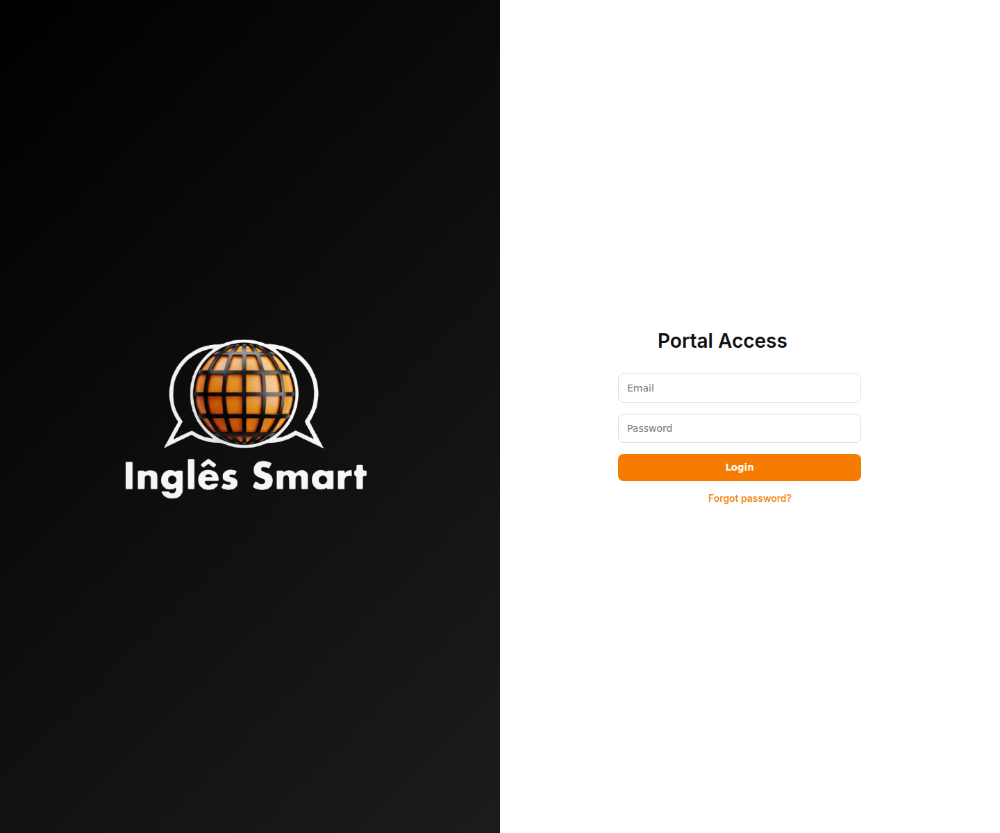
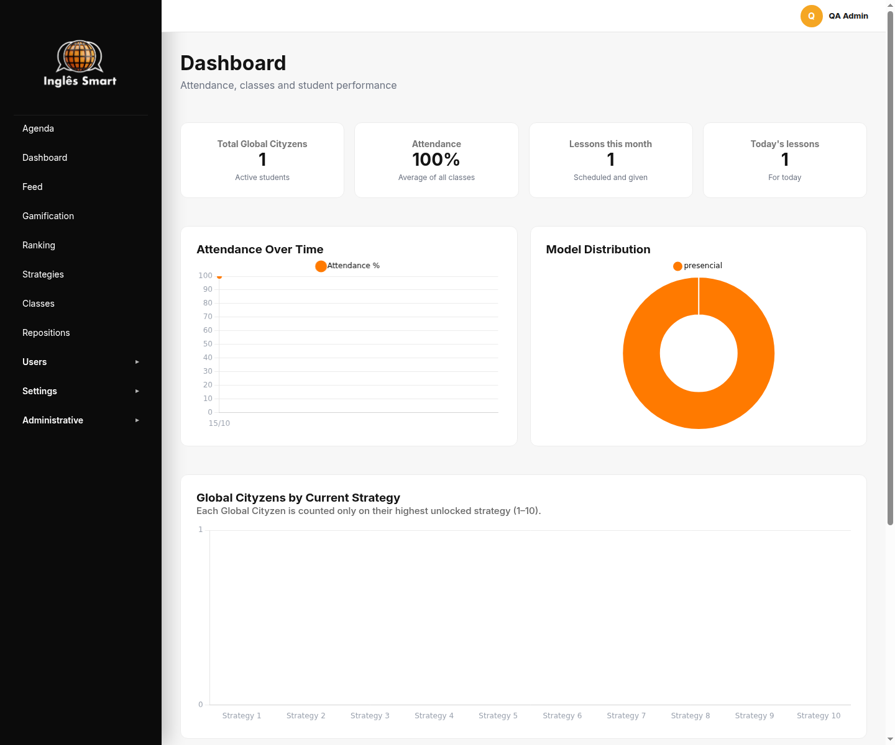
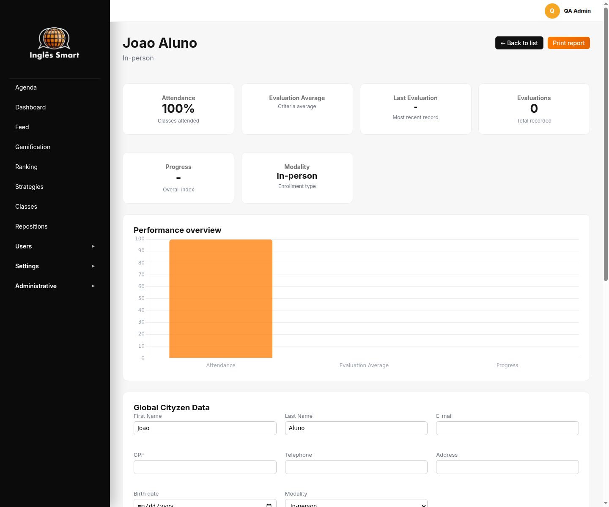
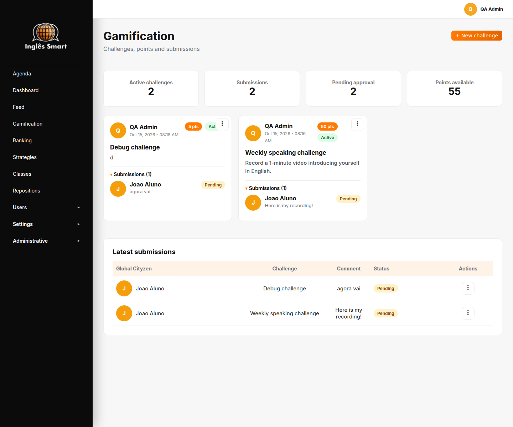
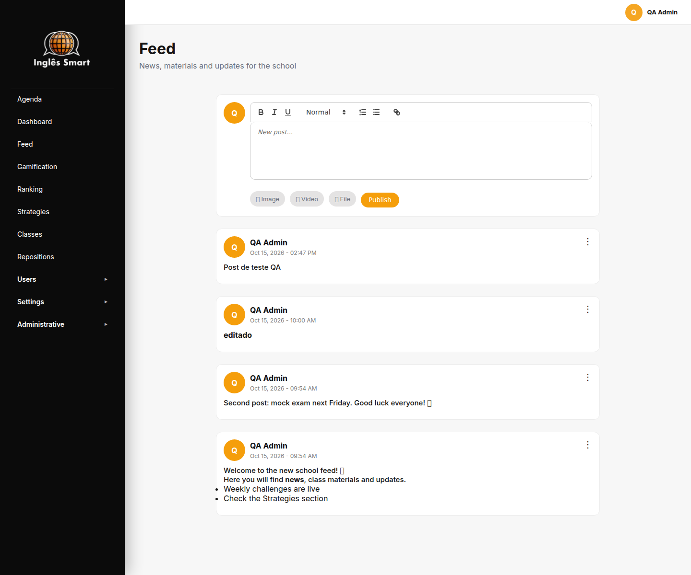
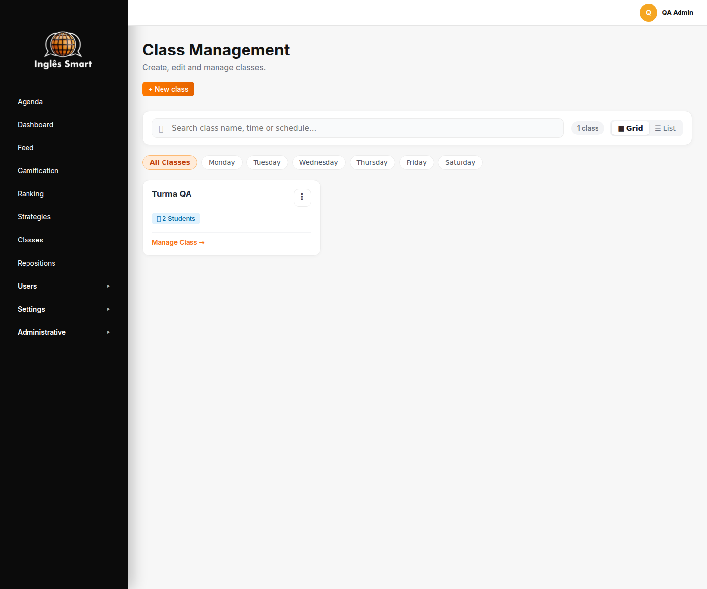
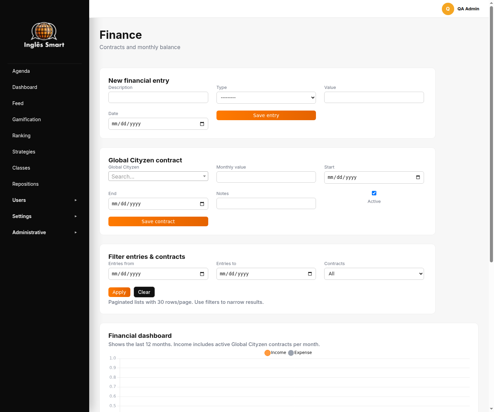

# 🎓 Inglês Smart — Sistema de Gestão Escolar & Plataforma de Ensino


> **Inglês Smart** é uma solução web completa (portal de ensino) para a gestão
> administrativa, acadêmica e pedagógica de escolas de idiomas: turmas e horários,
> presenças e reposições, avaliações por competência, financeiro, gamificação com
> ranking e um feed de conteúdo — além do portal do aluno como PWA instalável.

Projeto **entregue a uma escola de idiomas** e mantido aqui como peça de portfólio.

---

## 📸 Telas

| Login | Dashboard |
|---|---|
|  |  |

| Perfil do aluno | Gamificação |
|---|---|
|  |  |

| Feed | Turmas |
|---|---|
|  |  |

| Financeiro |
|---|
|  |

---

## 🚀 Funcionalidades

### Administração & Professores
- 👥 **Alunos e professores** — cadastro, perfil detalhado, ativação/desativação, reset de senha e **troca de senha obrigatória no primeiro acesso**
- 📅 **Turmas, horários e agenda** — agenda diária e mensal, grade de horários, períodos de recesso e calendário semanal por turma
- 📝 **Presenças e reposições** — chamada online e agendamento de aulas de reposição com histórico por aluno
- 📊 **Avaliações** — notas por competência/nível, médias e **relatório do aluno pronto para impressão**
- 💰 **Financeiro** — contratos, lançamentos e painel com gráficos
- 📢 **Feed e materiais** — avisos com imagem/anexo e biblioteca de estratégias com áudio e PDF

### Portal do Aluno (PWA)
- 🏆 **Gamificação** — desafios com pontuação, envio de comprovações, validação pelo professor e ranking
- 🎧 **Central de estratégias** — materiais em PDF e player de áudio integrado
- 📲 **PWA** — instalável em Android/iOS, com suporte offline básico e navegação responsiva

---

## 🛠️ Stack

- **Backend:** Python 3.12, Django 5.2, Gunicorn, WhiteNoise, `dj-database-url`
- **Frontend:** HTML5, **CSS próprio** (design system com tokens), JavaScript vanilla, CKEditor 5, Select2, Chart.js
- **Banco:** PostgreSQL em produção / SQLite em desenvolvimento
- **Mídia:** AWS S3 ou Cloudinary (configurável)
- **Qualidade:** 8 testes automatizados (`manage.py test`)

---

## 📁 Arquitetura

O projeto é dividido em **um pacote de configuração** e **apps por domínio** —
cada app com seus models, views, forms e templates:

```text
ingles_smart/                      # raiz do projeto
├── ingles_smart/                  # pacote de configuração (settings, urls, wsgi/asgi)
├── accounts/                      # autenticação, perfil, permissões, PWA, relatórios
│   ├── static/                    # CSS/JS, ícones do PWA, Select2
│   └── templates/                 # interface web
├── academico/                     # níveis, professores, alunos, turmas, horários, aulas, presenças
├── avaliacoes/                    # competências, avaliações e notas
├── feed/                          # posts, imagens, arquivos e tarefas
├── gamificacao/                   # desafios, submissões e mídias
├── estrategias/                   # estratégias de estudo e controle de acesso
├── financeiro/                    # contratos e lançamentos
├── onboarding/                    # itens de integração do aluno
├── build.sh / start.sh            # build e start de produção
└── manage.py
```

---

## 🧭 Notas de engenharia

O sistema nasceu como um **app único** e passou por uma refatoração completa
(apps separados por domínio, segurança e redesenho das telas). Pontos que valem
destacar:

**Separação de apps sem downtime de banco.** Os 30 models que viviam em um único
app foram distribuídos em 8 apps usando migrations `SeparateDatabaseAndState` com
`db_table` preservado: o schema relacional **não muda** — as tabelas continuam as
mesmas, o que permite migrar o código sem risco para os dados existentes.

**Segurança.**
- `SECRET_KEY` obrigatória por variável de ambiente (nenhum fallback no código)
- `ALLOWED_HOSTS` sem curinga e `DEBUG` desligado por padrão
- **Sanitização de HTML no servidor** com `nh3` nos posts do feed (fecha XSS
  armazenado), com comando de limpeza para o conteúdo já gravado
- Ações de escrita (excluir/fixar post) exigem **POST com CSRF** — não são links GET
- Autorização por grupos, com superusuário reconhecido como diretoria
- Página do aluno recebe apenas as **próprias** submissões no contexto

**Verificação.** Além dos testes automatizados, o projeto tem um script de QA que
percorre **todas as rotas em 3 papéis** (anônimo, admin e aluno) procurando
respostas 5xx, exceções e problemas de markup — foi assim que apareceram bugs
reais como uma página com template inexistente e uma tela que quebrava sem
parâmetro.

---

## 🚀 Como executar localmente

**Pré-requisitos:** Python 3.12+ e Git.

```bash
# 1. clone
git clone https://github.com/marcusvgcruz/ingles_smart.git
cd ingles_smart

# 2. ambiente virtual
python3 -m venv .venv
source .venv/bin/activate        # Windows: .\.venv\Scripts\Activate.ps1

# 3. dependências
pip install -r ingles_smart/requirements.txt

# 4. variáveis de ambiente (o exemplo já vem com DEBUG=True e uma chave local)
cp ingles_smart/.env.example ingles_smart/.env

# 5. banco + usuário admin
cd ingles_smart
python manage.py migrate
python manage.py createsuperuser

# 6. servidor
python manage.py runserver
```

Acesse `http://127.0.0.1:8000/`.

### Testes

```bash
python manage.py test
```

---

## 🌐 Deploy

O repositório traz infraestrutura como código (`render.yaml`) e três guias:

- 📖 [Deploy no Render.com](RENDER.md)
- 📖 [Migração SQLite → PostgreSQL](MIGRAR_POSTGRES.md)
- 📖 [Deploy em VPS (Nginx + Gunicorn)](DEPLOY.md)

> O sistema foi entregue à escola e **não está mais publicado** por este
> repositório; os guias ficam como referência de implantação.

---

## 📄 Autor & licença

Desenvolvido por **Marcus Cruz**

- **GitHub:** [@marcusvgcruz](https://github.com/marcusvgcruz)
- **LinkedIn:** [in/marcusvgcruz](https://www.linkedin.com/in/marcusvgcruz)

> Observação sobre dependências: o editor **CKEditor 5** (`django-ckeditor-5`) é
> distribuído sob GPL-2.0-or-later; verifique os termos antes de uso comercial.
